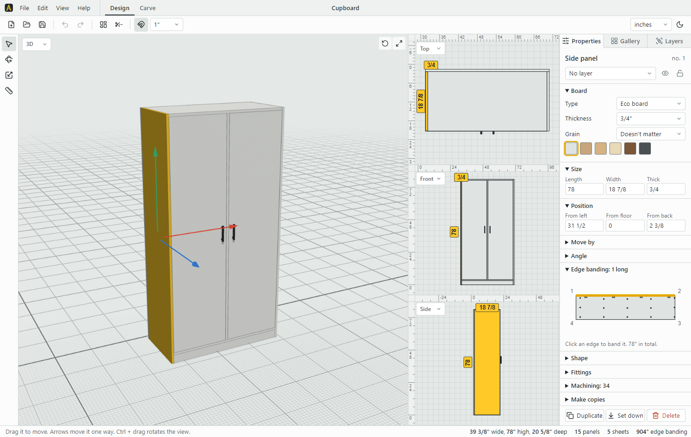
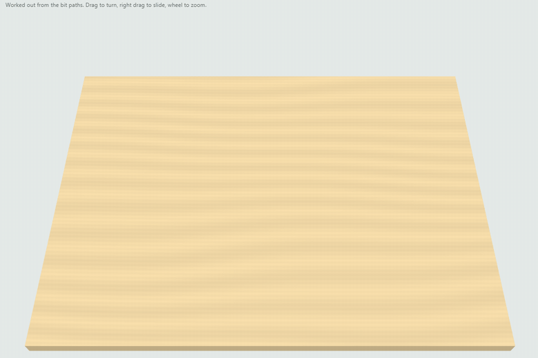
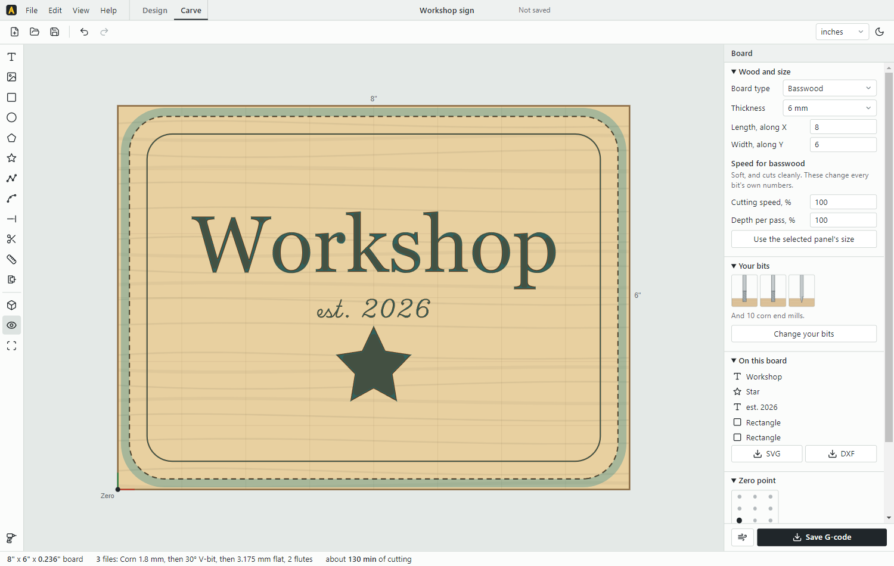
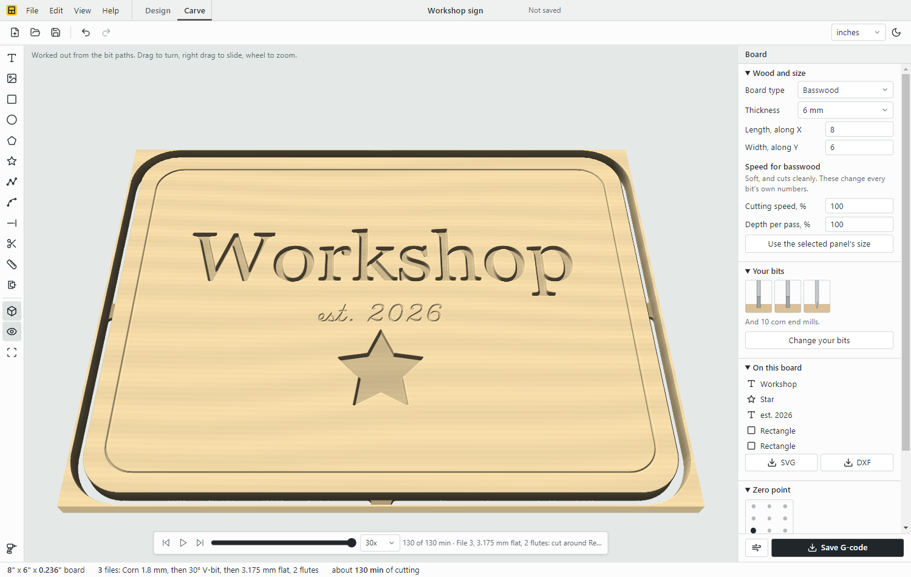

# Atelier

A desktop furniture design app for Windows, with CNC carving built in. Everything is a free panel or object: add boards, move and rotate them in 3D or flat views with snapping, then get a cut list, cutting plan, shopping list and workshop drawings. It also imports whole houses from Sweet Home 3D, to design furniture inside them.



**Carve** turns a board into G-code for a small GRBL router: text in any font or single-line engraving fonts, SVG, DXF and traced pictures, and shapes drawn with its own tools. It V-carves along the centre of each stroke, pockets, drills, engraves and cuts out with tabs, one file per bit, and shows the board as it will come out, played back cut by cut. Pockets clear in rings or straight lines, with a narrower bit after for the corners, and STL models carve as 3D reliefs, roughed out and then finished, by one bit or two. Sizes, positions and depths can follow smart values, the same named parameters the design uses. Bits can be flat, V or ball nose. Right-click for copy and paste, mirroring, breaking apart and filling the board, and choose to show uncut areas in red, shapes as outlines, and the board and wasteboard in 3D.



| Drawn on the board, with the bit's paths | As it will come out |
|---|---|
|  |  |


Current version: **1.0.32**. Updates come from this repository's releases. Free for noncommercial use under the [PolyForm Strict License 1.0.0](LICENSE): no changes or redistribution.

## Notes

- **Never cut from the G-code without simulating it first.** It's only been checked by the tests' own reader, never on a machine. The hole sizes for hinges, cams and slides are common defaults, to be matched to the hardware actually bought.
- **Furniture libraries:** `.sh3f` import has only been tested on a file built by hand from the test house's models, not on a real downloaded library.

## Project layout

There is no framework or bundler. The scripts in `src/` are plain scripts loaded in order and share one scope, so their order in `index.html` matters only for code that runs at load. Changes are in git; run `npm test` before committing.

| Path | What it is |
|---|---|
| `index.html` | The page: its HTML and the list of scripts |
| `src/app.css` | All styles |
| `src/model.js`, `edit.js`, `formulas.js` | Items, undo and units; parameters, formulas and Make resizable |
| `src/view3d.js`, `flat.js`, `precision.js`, `render.js`, `properties.js` | 3D, flat views, typed moves and guides, photoreal pictures, the side panel |
| `src/cutlist.js`, `machining.js`, `hardware.js`, `drawings.js` | Cut list and checks; holes, DXF and G-code; hinges and slides; workshop drawings |
| `src/carvepaths.js`, `carve.js`, `carvetools.js`, `carveview.js` | Carving: SVG, STL and font reading, bit paths and GRBL G-code; the Carve workspace; its drawing tools; its right-click menu and what's shown |
| `src/library.js`, `files.js`, `safety.js`, `ui.js`, `commands.js` | My items; saving and imports; autosave and versions; menus and start-up; command list and shortcuts |
| `test/` | Tests that drive the real app (`npm test`), each with its own empty data folder. `test/vdesk/` is a tiny C helper the test copy of the app loads to move its windows to virtual desktop 1 (Windows only lets an app move its own; `desktop.ps1` reads the desktops' order from the registry). `build.ps1` builds it with Visual Studio's compiler and no Windows SDK; the harness builds it when `vdesk.node` is missing, and windows open as usual if it can't. `ATELIER_TEST_DESKTOP` picks another desktop by number, or `off` |
| `main.js` | Electron window, single-instance lock, auto-update, opening a double-clicked `.atlr` |
| `preload.js` | Bridge for title bar colours and file opening (`window.atelierWin`) |
| `lib/` | `linefonts.js` (11 single-line engraving fonts from the npm package hersheytext 2.0.0, MIT, with each font's own notes kept at its top as the Hershey terms require), three.js r128, OrbitControls, Lucide icon subset (`icons.js`), Barlow fonts, app icon, Clipper 6.4.2 (`clipper.js`, shape offsets), opentype.js 1.3.4 (`opentype.min.js`, font outlines) |
| `scripts/release.js` | Builds and publishes a GitHub release (`npm run release`) |
| `scripts/publish-local.js` | Copies the build to the old local update folder |
| `scripts/readme-images.js` | Makes the README pictures and animation in `docs/` from the app, off the screen like the tests (needs ffmpeg) |
| `LICENSE` | PolyForm Strict 1.0.0, and the bundled libraries' own licences |
| `old-box-version.html` | The rejected first version, kept for reference |
| `Corner rack - rounded.json` | The user's rack design with panel sizes rounded, in the older format |

`lib/icons.js` is a **subset** of Lucide. An icon name that isn't in it renders blank, so check with grep first.

## Build and release

```
npm run release
```

1. Raise `"version"` in `package.json` first. `scripts/release.js` refuses a version that's already released.
2. This builds the NSIS installer and publishes it, with `latest.yml` and the blockmap, as release `v<version>` of `github.com/lakshanjs/atelier`. The upload uses the GitHub CLI's login (`gh auth login`), so no token is stored anywhere. The repo must be public for installed copies to read its releases.
3. The installed app checks GitHub shortly after launch and every 6 hours and downloads an update. Then a bar says it's ready (`showUpdateBar` in `src/ui.js`): Restart now saves the work at once and restarts into it (`update:restart`, `quitAndInstall`), and otherwise it installs when the app is closed. A page that reloads asks `update:waiting`, so the bar comes back.
4. It also copies the files to `D:\wamp\www\atelier-updates`, for copies built before the switch to GitHub (1.0.28 and older), which still check `http://localhost/atelier-updates/`. Once those have updated, that step can go. `npm run release:local` still does only the local copy.

Licence: PolyForm Strict 1.0.0 (`LICENSE`): anyone may use it for noncommercial purposes, but not change or redistribute it. The bundled libraries keep their own licences, listed at the end of `LICENSE`.

To install directly: `dist\Atelier Setup <version>.exe /S`. It installs to `%LOCALAPPDATA%\Programs\Atelier`. Installing closes a running copy, so check first.


## How the data works

- **`P`** is the project: `items`, `groups` (shown as "Layers"), `levels`, `dims`, `unit` and so on. All lengths are stored in **mm**.
- **`edit(fn)`** is how changes are made. Every undo step stringifies all of `P`, so **never put large data in `P`**.
- **Autosave** writes `P` to localStorage (`furniture-panels-2`) and, shortly after, to IndexedDB (`autosave`), which wins if it's newer or the first is full. Electron's storage is separate from Chrome's.
- **Versions** are in IndexedDB (`snaps`, `snap:<time>`): the last 40 automatic ones plus every named one.
- **Crash note:** `main.js` keeps `running.lock` in the data folder while running. Script errors go in `errors.log` beside it.
- **Formulas:** see the top of `src/formulas.js`. `persist()` runs `fxUpdate()`: a value changed by hand loses its formula, and a whole layer moved together shifts its Left, Floor and Back instead.
- **Machining** is worked out from how panels touch and never stored, except holes and grooves added by hand (`it.ops`). Settings are in `P.mach` and `P.cncTool`, with defaults at the top of `src/machining.js`.
- **Models and textures** live in the runtime `MODELS` and `TEXTURES` maps and in IndexedDB (`furniture-files`, keys `model:*` and `tex:*`). Items only hold keys to them.
- **Library (My items):** `{ folders, items }` in IndexedDB under the key `library`, moved from the old localStorage key `furniture-library` the first time it loads. Entries hold `items`, `size`, `folder` and a small `thumb` image, and only point at models by key. Removing an entry leaves its model and textures in IndexedDB.
- **No room by default:** `newProject` starts with no walls or floor and sets `noRoom`, so `ensureFloor` leaves it alone. Older projects without that flag keep theirs. Walls and floors can still be added from the gallery, and the 3D view's grid (`floorGrid`) is only a guide, turned off with View > Floor grid.
- **Items:** `kind: 'panel'` goes on the cut list. `kind: 'object'` doesn't. `isRoomPart` covers walls and floors. Local axes: `l`→x, `t`→y, `w`→z.
- **Naming:** the UI says "Layers", while the code and data still say `group`. Old storage keys still say `furniture-*`. Both are deliberate, to keep existing saves working.
- **Picking:** in Design, a click picks the whole layer (`pickMode`, the Layer / Part switch on the toolbar, kept in localStorage `atelier-pick`); a double-click picks the other way. `pickedBy` applies the mode to clicks, boxes and the 3D hover outline. Ctrl+G (`groupSelection`) makes a layer, Ctrl+Shift+G (`ungroupSelection`) takes the selection out of its layers, and layers left empty go (`dropEmptyLayers`) unless they hold parameters. Right-click in Layers offers the same for levels, layers and parts (`layerCtxRun` presses the row's own buttons). A gallery object or library entry comes in its own layer (`newLayer`, which numbers repeated names); walls and floors join the Room layer; boards, panels and handles get none.
- **3D picture:** `savePicture` keeps the measurements: their lines are in the scene, and their numbers are painted on, since on screen they're HTML over the view.

## File format: `.atlr`

A zip file, handled by `atelierBytes()` and `openBytes()` in `index.html`:

- `project.json`: `{ format: 'atelier', version: 1, project, view, models, textures }`
- `models/<m>/<part>.p|n|i|u`: positions (Int16, -1 to 1), normals (Int8), indices (Uint32), UVs (Float32)
- `textures/<n>`: original image bytes

Older `.json` projects still open, and saving one prompts for a new `.atlr`. Raise `version` if the format changes in a way old apps can't read. They refuse newer files.

## File format: `.atlib`

A saved library, written by `libPackBytes()` and read by `libTakePack()`. A zip with:

- `library.json`: `{ format: 'atelier-library', version: 1, folders, items, models, textures }`
- `models/<n>`: one file per model, its parts' arrays end to end, with their byte lengths in `parts[].len`. One file each because a zip made here is limited to 65,535 files.
- `textures/<n>`: original image bytes

## Main features

- **Measuring:** snaps to corners and anywhere along panel edges. Lines stay on X, Y or Z. Drag a dot to move an end, or click it to measure on from there. Typing a length moves the selected object attached to that end. Each measurement can be hidden on its own.
- **Scaling:** squares on both sides. The dragged side moves and the other stays fixed, and Shift grows both ways. Snaps to other objects' faces and to sizes other objects already have. Alt turns snapping off.
- **Units:** mm, cm, m, inches, feet, yards. Any size box accepts any unit, like `120cm` or `5' 3 1/2"`.
- **Layers tab:** levels are parents of layers. Levels can be hidden, shown on their own ("Only"), locked, renamed, added and removed, and layers can be moved between them. Levels only organise things and don't change heights.
- **Sweet Home 3D import:** walls with real openings, side colours and textures; rooms as floors and ceilings with their real outlines and textures; stair holes; all OBJ models with colours and textures.
- **Editable designs:** select parts and use Make resizable to get Width, Height and Depth. Any size or position box takes a formula like `=Width-36`; a plain number in one takes the project's unit, and sums like `800-36` are worked out once. Copies and library items of a whole resizable layer get their own parameters.
- **Machining:** joints, hinges, shelf pins and slides drill themselves. Holes and grooves can be added by hand in Properties.
- **Cut in Carve:** a panel's Machining section has Cut in Carve (`cvFromPanel`, `cvPanelJob`), which makes it the board in Carve, with a 10 mm margin, in its wood and thickness, the face with most work up (as `partLayout` chooses). Its outline is a through cut-out with tabs and a finishing pass; holes are drilled with a flat bit their size, or milled out (pocketed; through and under 30 mm cleared completely, so no loose disc is left); grooves are pocketed; cut-outs are cut through. Of bits the same size, the everyday one cutting the outline is preferred, so there are fewer bit changes. Edge holes, pocket-hole jig marks and work on the other face go in `P.carve.fromPanel.byHand`, shown in Carve as To do by hand. It replaces what was on Carve's board; Undo brings that back. This is the way to cut a panel on the GRBL machine, since Export for CNC still writes tool changes.
- **CNC:** File > Export for CNC gives a zip with a DXF and G-code per sheet, plus a CSV of what must be done by hand: edge holes and the other side. The DXF's layer names say what to do, like `DRILL_D5_Z12`.
- **Carve:** a mode inside the main window, from the Design and Carve tabs in the title bar, or File > Carve on a board. A project reopens in the mode it was left in (`P.carveMode`). While carving, `cvRoute` decides what menu commands do: some act on the board, some work anywhere, and the rest go back to Design. The board has a type and thickness (`P.carve.board`, `CV_WOODS`), with thicknesses shared with the design side. Each wood sets a percentage of every bit's feed, plunge and depth per pass (`cvRated`): the project keeps its own copy, and changes are remembered in localStorage (`atelier-carve-woods`). The starting percentages are cautious guesses. It puts text, SVG art, rectangles, ellipses, polygons, stars and drawn lines on one board (`P.carve`) and saves G-code for GRBL, sent with gSender: one `.nc` per bit, zipped and numbered when there are several, with no `M6` because GRBL refuses it. Jobs: engrave along lines, pocket, V-carve, cut out with tabs. V-carving (`cvCentreLine`) puts the tip at the centre of the widest circle that fits inside the shape touching each point of the outline, so walls are true and corners sharp; across a jump in that centre line it goes straight, no deeper than the V allows there. Past the deepest cut the bottom is level: `op.clear` names a flat bit to clear it first, in its own file (`cvVclearPaths`), or `auto` (the default) picks the widest owned flat bit that fits 70% of it (`cvAutoClear`). Without one the V-bit clears it with small ridges. Single-line fonts (`window.CV_LINE_FONTS`) are listed first in the font menu, lay out like outline fonts (`cvLineText`), and can only be engraved. Moves shorter than `CV_HOP` (5 mm) between cuts lift only to 1 mm above the board. Drilling (`cvDrillPaths`) goes straight down at the middle of each separate shape, with pecks written out as moves because GRBL has no drilling cycle; any bit can drill, so a V-bit makes spot dimples. Tiles (`P.carve.tile`, `cvTiles`) split a board bigger than the machine travel into a grid of equal tiles, each with its own numbered files and zeroed at its own front left corner: the board corner for tile 1, then a small cross (`cvMarkChains`) that the first tile able to reach it engraves. Cuts are clipped to tiles by their centre line (`cvClipChain`) and slope in again where they start at a tile edge. Drawing tools (`carvetools.js`): polygons and stars (`sides`, `points`, `inner`, `corner` for rounded corners, also on rectangles); a pen for lines and curves (`cvTool`; click points, click the first to close, double-click or Enter to finish, Shift for 45° steps, P to start) that makes `path` items, which hold their own outlines (`paths`) and can be smoothed (`smooth`, a curve through the points). Shift-click or a dragged box picks several (`cvSel` plus `cvMore`, read with `cvPicked()`); they move, nudge, copy and delete together, and their panel lines them up, spreads them, centres them, sets one job for all, and joins them: weld, cut away and overlap make one `path` item with the first one's job. One item can be mirrored (`mx`, `my`, applied in `cvPlaceFn` and `cvMatrix`), outlined inside or out as a new item, and copied in rows and columns or in a ring round the board's middle. Text can bend round an arc (`arc`, a radius; negative goes under the circle). Any item can be made a `path` (`cvToPath`, which fixes its own settings) and its points edited (`cvNodeEdit`): drag a point, double-click a line to add one, Delete removes the last one touched, Esc stops. A path keeps its points where they are rather than being re-centred on each draw, so `cvLocal` gives its middle as `ox`, `oy` and `cvRecentre` tidies it after edits without moving it; closed paths can have their corners rounded (`corner`). The import button takes SVG, DXF (`cvParseDxf`: lines joined where their ends meet, polylines with bulges, arcs, circles, ellipses, splines, in `$INSUNITS`) and pictures, which become `trace` items: the image is kept in `TEXTURES` under `img:*`, decoded lazily (`cvImgCache`, at most 800 px), split at `threshold` (Otsu at first), outlined along pixel edges and simplified by `detail`; `invert` traces the light parts. Round six: pockets and cut-outs can climb cut (`op.climb`; off is conventional, with a clockwise spindle). Curves go out as G2/G3 arcs (`cvArcFrom`, `P.carve.arcs`, on unless false) only where every point is within 0.005 mm of one circle and every chord is short enough to stay that close, so polygons are never rounded; the tests' reader checks arcs the way GRBL does (error 33) and follows them in short steps. Clamp zones are `clamp` items, never cut: no path may go into one (with the bit's radius and 0.5 mm), short hops over one go up to the safe height, and the safe height must clear `P.carve.clampH` (15 mm unless set; adding the first clamp raises the safe height if needed). `dim` items are dimensions, only drawn; the Measure tool catches on corners within 8 px. The Trim tool cuts the clicked stretch of a drawn line back to the nearest crossings with other lines or itself; a closed line is left open. An inlay plug (`cvMakePlug`) is the pocket as the bit cuts it (inside corners rounded), shrunk by the gap and rounded the same way, shrunk further until it fits, added beside the shape as a through cut-out. `cvShapeProblems` warns (never stops) about open lines a job leaves out, outlines that cross themselves, and identical copies on top of each other. Round seven: points of a drawn line can have handles (`l.c[i]` = [in x, in y, out x, out y], or null for a sharp corner; drawn by `cvBezLine`, and kept through moves, scaling and edits by `cvMapLine`). While editing points: Fit curves gives every point handles, a point can be made smooth or sharp, a corner rounded with a true arc or cut off, and dragging a handle swings its partner round unless Alt is held. The arc tool takes two ends and a point it passes through. Extend carries a drawn line on until it meets another; Join joins picked open lines at their nearest ends, closing a line whose ends meet. Groups (`gid`, Ctrl+G, Ctrl+Shift+G) are picked, moved and copied together; a copy gets a group of its own. Copy along a line spaces copies of one picked item evenly along a picked drawn line, turning to follow it. The board's panel saves the shapes as SVG or DXF (R12 polylines, `$INSUNITS` mm), which Carve's own import reads back. Point editing (`cvNodeEdit`) ends when Carve opens or closes, and only applies to drawn shapes. The 3D view plays the cut back (`cvCarveSteps`, `cvStamp`, `cvPlay*`): moves are timed the same way as the G-code estimate and cut into a flat board as time passes; going back starts again from flat. Flat bits slope into the wood (`cvRamp`, `P.carve.ramp` degrees, 0 for straight down): forward along the path and back, never below it, so the board comes out the same. Pockets and cut-outs can leave a skin (`op.finish`, 0.2 mm by default on cut-outs) taken off by one last pass at full depth; the rough passes put their tabs at the same places (`cvTabSpots`). Each tab moves, within its share of the edge, to the straightest stretch (least turning within its width plus 1 mm), so none lands on a point or a tight curve. Files bring the spindle up in four steps (`cvSpinUp`). A V-bit line shallower than 0.4 mm gets a note that it can come out faint. The other button by Save G-code saves an air test: the whole job lifted by its deepest cut plus `P.carve.airZ`, so even a through-cut runs clear of the board. A new item starts with the job last chosen for its kind (localStorage `atelier-carve-jobs`). Your bits are kept in IndexedDB (`bits`), and each project keeps a copy of those it uses (`P.carve.bitsUsed`). The starting list is the bits actually owned, for a TTC 3018 PRO with `S1000` as full speed, about 300 x 180 mm of travel and 1500 mm/min at most, taken from `E:\CNC\README.md`. `cvBitArt` draws each bit from its own numbers, to one scale where it fits; a job only offers ticked bits that suit it. SVG bytes live in `TEXTURES` under `art:*` keys, so they save with the project. Sizes show as decimals here, because `fmt` rounds inches to 1/8". X0 Y0 is any corner, the middle of an edge, or the middle (`P.carve.zero`, as parts of length and width; front left by default), and Z0 is the top. Only the G-code words are moved to it; everything inside stays in board coordinates. From a front left zero the travel checks are about distance from zero, from anywhere else only the job's overall size. The 3D button in Carve shows the board as carved: `cvCarveMap` runs each bit's real shape along the same paths as the G-code, and a shader (`CV3D_FRAG`) follows each pixel down to that surface, blending between grid points. Triangles on the grid left teeth along curved walls, which is why it isn't a mesh.
- **Workshop drawings:** A3 or A4 (`P.drawing.paper`): views, sections, exploded view with parts list, and each different part with its holes. Save PDF uses `printToPDF`.
- **Starting popup:** shows at first start, and from File > New. It never opens over a project: opening one stops it or closes it (`projectChosen` in `src/files.js`).
- **Version history:** File > Version history.
- **Hardware catalogue:** File > Hardware catalogue lists hinges and slides with their drilling, lengths and prices, kept in IndexedDB (`hardware`). Choose per project or per door and drawer. Each project keeps a copy of what it uses (`P.hwUsed`), so files stay correct on another computer. The starting entries are generic values, not any maker's specification.
- **Precision:** during a drag, or right after it, type a number and press Enter for an exact move, size, turn or scale. X, Y or Z holds a move to that direction, and Esc cancels a drag. Move by and Turn by are in Properties, with an angle snap setting (Shift gives 90°) and Lock this angle. Guides (`P.cguides`) come from dragging off a flat view's ruler; drag one back onto a ruler to delete it. The readout names what a drag snapped to, and that item is outlined.
- **Carve's 3D view is editable:** a click picks (the item whose outline box holds the point, smallest first; Shift adds), a drag on an item moves it, and the handles drawn over the view (`#cv3dOver`, `cv3dOverlay`) scale and turn it. The pointer is followed onto the board's top face (`cv3dPt`), and the board's own drag code does the rest (`cvItemDown`, `cvHandleDrag`, `cvDragTo`), so both views behave the same. Right-click opens the board's menu. The import button and dropping on the board take several files at once (`cvImportFiles`), laid out in a grid across the board.
- **G-code files** (`src/gcodeview.js`): File > Open, Carve's import button or a drop takes `.nc`, `.gcode`, `.ngc` and `.tap` to be looked at, not edited. `cvGcodeParse` follows G0 to G3 (arcs in short steps, I J or R, G20/G21, G90/G91) and reports what GRBL 1.1 would refuse, a rapid ending in the wood or going sideways below its top, and arcs off by more than GRBL allows. The moves are played and cut in the 3D view from the board's zero (`cvGcodeBake`, through `CV3D.gcode`) with a bit guessed from the comments (`cvGcodeGuessBit`). Opened from a design, it makes a new carving with the board fitted to the job.
- **My machine** (`src/machine.js`, File > My machine, or Send to machine in Carve and the G-code viewer): drives GRBL 1.1 directly, like Candle or Easel. USB uses Web Serial; Electron has no port chooser, so the page names the port it wants (`serial:want`) and `main.js` picks it in `select-serial-port` (`?` only lists). Wi-Fi is telnet, opened in `main.js` (`tcp:*`), since a page can't open sockets; telnet's own bytes are dropped. Practice is a simulated GRBL (`machSim`) for trying it, and for the tests. Lines are sent (`machPump`, `machJobFeed`) either by character counting within GRBL's 127-byte buffer (Fast) or one at a time, waiting for each `ok`. Machine profile > Sending chooses; Automatic (`machProfile.send` empty, `machOneByOne`) is one at a time over Wi-Fi, because an MKS DLC32 restarted itself mid-job three times when Candle streamed to it over Wi-Fi and ran a 35-minute job cleanly one line at a time (not proven the cause). If the planner keeps running empty (`Bf:` in the status) while sending one at a time, the console says so once (`machWatchStarve`). Comments are stripped, and each line keeps its line number to follow the cut in 3D. A `Grbl` greeting mid-job that nobody asked for is a restart: the job stops, `machRestartInfo` notes the line, the depth if every line the planner could still have held was at one depth, and the start of the cut it was on (the line after the bit was last above the board), and Find zero again opens. There, a point of the cut is picked on Carve's board (`machPickAt`, snapping within 15 px to the end of a cutting move in the file being sent, `machCutPoints`; drawn by `machPickSvg`) or typed, the bit is jogged onto it, and `G10 L20 P1 X Y` sets it. Set Z0 from the cut uses the depth and how far Z has moved since the restart (the first status after it, `m0`). The Job section's From line starts part-way (`machResumeLines`): up to the safe height, the spindle up in steps, over where that line starts, down to its height, its feed, and the file's motion word put on the first line if it has none; it refuses a file with G91 before that line, and resets to 1 once started. Paper test (`machPaper`) goes to 0.2 then 0.1 mm, and each answer moves Z0 by half a step. Start's checklist asks about a spoilboard when the file cuts as deep as the board. A Wi-Fi connection dropped within 4 s, or no answer in 5 s, says another program may have the board, which talks to one at a time. The practice machine's `reboot()` restarts it the way a real board does: position counted from zero, work offsets kept. A refused line holds the job; Check runs it under `$C`. Jog by steps or held (`$J=`, cancelled with 0x85, and on losing focus), zero with `G10 L20 P1`, spindle `M3`/`M5`, and feed, rapid and spindle overrides. Start asks Easel-style questions first. The red STOP (and the Pause key) sends a reset at once; Stop the job holds first, then resets that same connection only. `$` settings are never written. The profile (`atelier-machine` in localStorage) gives new carvings their travel, top speed and safe height (`machDefaults`, merged into `CV_DEFAULT`).
- **Photoreal picture:** File > Photoreal picture path-traces the current 3D view on the graphics card (`src/render.js`). It takes everything the 3D view draws, from `group`. Daylight or Studio light, sun position, optional room, up to 4K. The picture sharpens as samples add up, and work is sent in small bands so the app stays responsive.
- **Commands and shortcuts:** Ctrl+K finds any menu command or tool by name, most recent first. Help > Keyboard shortcuts edits the keys, kept in localStorage (`atelier-keys`). A key that's already in use moves to the new command, and the menus and tooltips show the current keys. Arrows, Esc, Tab and Enter stay fixed. All key handling is in `src/commands.js`, apart from those fixed ones in `src/files.js`.
- **Library:** File > Import to library takes an OBJ model in a zip, a `.sh3f` furniture library, a `.sh3d` home or an `.atlib`, without touching the open project. Pieces already there are skipped. Folders can be added, renamed by double-click, and items dragged onto them. The gallery filter shows all, stock, imported or saved items, and works with search. An entry counts as imported if it uses a 3D model.
- **Toolbar:** drag any menu item onto it, drag along it to reorder, drag off to remove. Right-click for separators. **View > Reset toolbar** restores it. Stored per user in localStorage (`atelier-toolbar`).
- **Window:** no Windows title bar. The app's title bar uses real Windows buttons drawn over it (`titleBarOverlay`, `BAR_HEIGHT` in `main.js`, 33 px under a 34 px bar so the border shows).

## Known limits and things to check

**Not done**
- The Sweet Home 3D import is one-way: Atelier can't save back to it.
- A plain OBJ doesn't say what unit it uses, so `libGuessMm()` picks the first of cm, mm, m, feet or inches that gives a likely size. It may be wrong, and it can be scaled once placed.
- A plain OBJ's front may face any way, because it has no rotation data.
- Library import reads OBJ models only. Other formats in a `.sh3f` are counted as couldn't be read.
- Doors and windows added from the library don't cut an opening in a wall.
- Turning a resizable part stops its position formulas. Make resizable only understands straight parts: angled ones just keep their size.
- Rectangular and round cut-outs and corners stay measured from the panel's centre when it's resized.
- Part drawings show holes on the top and bottom faces from above, and edge holes as ticks. There's no separate edge view.
- Carving: not yet run on a real machine, so air-cut first. Letters are placed without complex-script shaping, so scripts like Sinhala or Arabic may not join correctly. Fonts in collection files (`.ttc`, like Cambria) may not read.
- File > Export for CNC still writes `T1 M6`, which GRBL refuses with `error:20`, so that export won't run in gSender as it is. Use Cut in Carve for that machine.
- G-code machines one side. Edge holes and the other side are listed in the CSV. Parts are held by a thin skin, not tabs.
- Slides are modelled as side-mounted, with screws in a line at the drawer's mid height. Undermount slides aren't.
- Renders ignore the section slice. Materials are colour, texture and roughness only, with simple glass (no bending of light). There are no lamps, so closed rooms are lit only by what comes through openings, plus Brightness.
- Baseboards aren't imported. The test house has none.
- Textures set on a whole piece use the model's own mapping, so some may look a different scale than in Sweet Home 3D.
- Selected thickness names stay as written (like `3/4"`) in every unit.
- Roof and tree groups are matched by words in piece names (`toit|roof|skylight`, `tree|palm|shrub|bush|suv`).

**Built but only partly tested**
- Toolbar dragging was tested with simulated drags, not by hand.
- Double-clicking an `.atlr` in Explorer: the file type is registered and launching with a file works, but a real double-click wasn't tried.
- The taskbar name: the window title is right (`<project>.atlr - Atelier`), but the taskbar itself couldn't be seen.
- The Windows buttons and the title bar border can't be captured in screenshots, so the user has to confirm those.
- Renaming a level and locking a whole level weren't exercised.

**In the test house, by design**
- Only 1 stair hole is cut, because only the straight staircase reaches Level 1. The spiral stops about 26" below that floor, which may be a mistake in the user's original file. They were asked whether it should reach Level 1 and haven't answered.

## Keeping it smooth

- The 3D view draws only when something changes (`loop` in `src/view3d.js`). With nothing happening it checks about 12 times a second, and any mouse or key wakes it. Anything that changes the picture must set `dirty`.
- Photoreal pictures send the graphics card small pieces (`REND_PIECE_MS` in `src/render.js`). On a shared chip they rest between pieces so the desktop stays smooth. On a dedicated card they barely rest.
- On laptops with two graphics chips, Atelier asks for the fast one (`force_high_performance_gpu` in `main.js`, `powerPreference` on every WebGL context). Without that, Chromium picks the slow built-in one.
- Scenes over `BIG_SCENE` triangles combine small objects sharing a material (`batchSmall`), because drawing hundreds of separate things is what's slow, on Intel graphics especially. The originals stay hidden in `group`, because clicks test them.
- Shadows are recalculated only when the design changes (`renderer.shadowMap.needsUpdate` in `draw3D`), not when the camera moves.
- Scenes over `BIG_SCENE` triangles hide small, detailed models while the camera moves, and bring them back as soon as it stops.
- `modelGeo` sets bounding spheres by hand, because three.js r128 misreads normalized attributes, which would stop off-screen models being skipped.
- `test/performance.test.js` checks idle CPU, memory growth and how politely a render behaves.

## Testing

Run `npm test`. It opens real copies of the app with their own empty data, so it never touches your work, but it does use the graphics card while it runs.

A running copy can be driven and screenshotted over the Chrome DevTools Protocol. To run alongside the user's Atelier, it needs its own data folder, because of the single-instance lock. Make a small launcher folder with this as `main.js` and a `package.json` pointing at it:

```js
const { app } = require('electron');
app.commandLine.appendSwitch('disable-backgrounding-occluded-windows');
app.commandLine.appendSwitch('disable-renderer-backgrounding');
app.setPath('userData', 'C:/path/to/some/temp/folder');
require('D:/playground/atelier/main.js');
```

```
node_modules\electron\dist\electron.exe <launcher folder> --remote-debugging-port=9336 [file.atlr]
```

- Read pages from `http://127.0.0.1:9336/json`, then use `Runtime.evaluate` over the WebSocket. App globals like `P`, `MODELS` and `render()` are reachable.
- Without those two switches, the renderer pauses when the window is covered, and screenshots hang.
- `DOM.setFileInputFiles` on `#sh3dIn` or `#fileIn` loads a file without the native dialog.
- Large results can break the connection, so fetch big data in pieces of about 3 MB.
- Reloading picks up `index.html` changes. Changes to `main.js` or `preload.js` need a restart.
- Don't test in a window the user is working in. A reload loses their undo history.
- Native file dialogs and the Windows buttons can't be driven this way.
